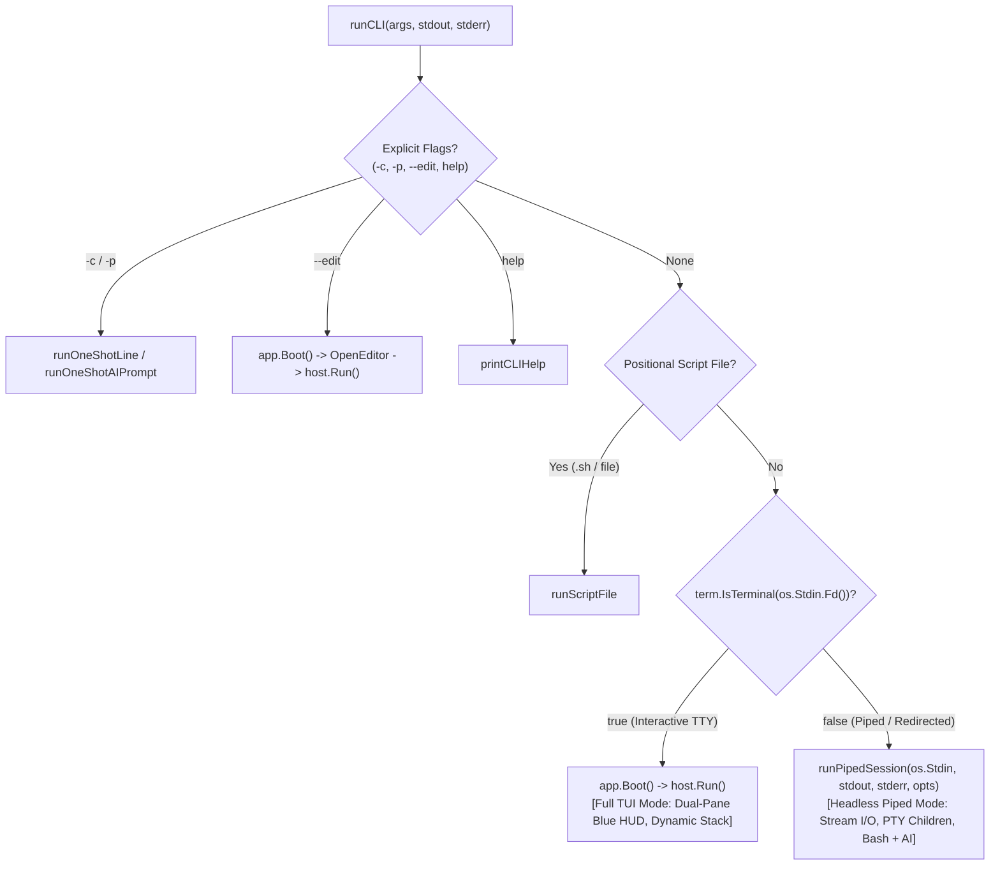

# Kabibi Architectural Plan: Early-Fork Headless Shell with Retained PTY & AI Execution

## 1. Executive Summary & Design Decision

Kabibi operates in two execution modes based on terminal detection:
1. **Interactive Full-TUI Mode (`isTTY == true`):**
   - Raw terminal mode on stdin (`term.MakeRaw`).
   - Full Norton Commander-style HUD (`DualPaneWidget`, Ctrl+O, F2-F8 dialogs).
   - Dynamic inline stack widget, cursor repositioning ANSI codes, and double-buffered cell diffing (`terminal.CellBuf`).
2. **Headless Piped Mode (`isTTY == false`):**
   - Standard stream I/O from `os.Stdin` to `os.Stdout`/`os.Stderr`.
   - **Early fork** in `kabibi/main.go` that completely bypasses `app.Boot()`, `AppWidget`, and `ui.Host`.
   - **Retains full PTY execution for child processes** (both user-piped commands and AI tool executions).
   - Sequentially executes shell commands and natural-language AI prompts using the shared `shell.ExecutionSession` and `shell.LazyAIRunner`.

---

## 2. PTY Retention for Child Processes

### 2.1 Why Retain PTY in Headless / Piped Mode?

Rather than degrading child processes to raw dumb pipes, **retaining PTY allocation for child processes provides a unified, powerful execution engine**:

1. **Consistent Child Behavior:**
   - CLI tools, build runners, linters, test harnesses (`cargo`, `git`, `python`, `node`, `go test`) see an `xterm-256color` terminal.
   - They output full rich diagnostic formatting, color, and structure identically to how they run in the interactive TUI.
2. **Uniform Codebase:**
   - Kabibi's core child-process executor in `shell.go` (`runResolvedCommand`) uses `pty.Start(cmd, ...)`.
   - Output from the PTY master is read via a simple pump goroutine and written directly to `hc.Stdout`.
   - We do not need separate "pipe vs. PTY" process spawning branches. The exact same PTY launch pipeline serves both interactive and piped modes.
3. **PTY Sizing:**
   - In headless mode, terminal size detection falls back gracefully to a standard geometry (e.g. 80x24 or columns queried from stdout/environment `COLUMNS`/`LINES`), ensuring child tools format their output cleanly.

---

## 3. Child Processes Fired from AI Chat (`exec` Tool)

When a piped session encounters a natural-language prompt or an unresolvable command (`ErrUnknownCommandAtStart`), it routes to `LazyAIRunner`.

### 3.1 AI Child Process Architecture
The AI agent interacts with the system using its `exec` tool. Inside `ExecutionSession`:
1. **`ExecuteAIToolCommand` $\rightarrow$ `ManagedPTY`:**
   - The AI tool launches the requested command in a dedicated `ManagedPTY` (`pty.Start`).
   - Output accumulates in an internal buffer.
2. **Virtual Terminal Settling (`terminal.FromANSI`):**
   - While the command runs, any transient `\r` cursor rewrites or spinner ticks are collapsed into a virtual 2D grid via `CleanBytesToText`.
   - The AI receives the settled, legible diagnostic text without noise.
3. **Interactive & Long-Running Tool Support:**
   - If a command times out (default 15s), it is promoted to a background process handle (`pid_id`).
   - The AI can continue interacting with it via `term_read`, `term_input` (sending keys like `<enter>`, `<ctrl+c>`), or `term_kill`.
4. **Stream Output:**
   - The child process's internal PTY output is consumed by the AI model.
   - The AI's generated response content is streamed straight to Kabibi's `stdout`.
   - Diagnostic tool lead messages (e.g. `[exec: cargo check]`) go to `stderr` only if `--verbose` is enabled.

---

## 4. Headless Stream Architecture & Lifecycle

### 4.1 Entrypoint Routing (`kabibi/main.go`)



### 4.2 Stream Execution Loop (`runPipedSession`)

The headless session controller is implemented in `kabibi/piped.go`:

```go
package main

import (
    "bufio"
    "bytes"
    "context"
    "errors"
    "fmt"
    "io"
    "os"
    "strings"

    "github.com/mavity/rusticated/kabibi/ui/shell"
    "mvdan.cc/sh/v3/syntax"
)

func runPipedSession(stdin io.Reader, stdout, stderr io.Writer, opts cliOptions) int {
    if stdin == nil {
        stdin = os.Stdin
    }
    if stdout == nil {
        stdout = os.Stdout
    }
    if stderr == nil {
        stderr = os.Stderr
    }

    // 1. Read input stream into memory
    var inputBuf bytes.Buffer
    if _, err := io.Copy(&inputBuf, stdin); err != nil {
        fmt.Fprintf(stderr, "kabibi: reading stdin: %v\n", err)
        return 1
    }
    rawInput := inputBuf.String()
    if strings.TrimSpace(rawInput) == "" {
        return 0
    }

    // 2. Initialize persistent ExecutionSession and LazyAIRunner
    es, err := shell.NewExecutionSession("")
    if err != nil {
        fmt.Fprintf(stderr, "kabibi: session init: %v\n", err)
        return 1
    }
    aiRunner := shell.NewLazyAIRunner(es)
    aiRunner.SetVerbose(opts.verbose)
    defer aiRunner.Close()

    ctx := context.Background()

    // 3. Attempt whole-script parse first (for compound statements, loops, scripts)
    parser := syntax.NewParser(syntax.KeepComments(false))
    file, parseErr := parser.Parse(strings.NewReader(rawInput), "stdin")
    if parseErr == nil && len(file.Stmts) > 0 {
        rec, runErr := es.RunCommand(ctx, rawInput, file, shell.SourceUserShell, func(chunk []byte) {
            _, _ = stdout.Write(chunk)
        })
        if runErr == nil {
            return 0
        }
        if !errors.Is(runErr, shell.ErrUnknownCommandAtStart) {
            if rec.ExitCode != 0 {
                return rec.ExitCode
            }
            return 1
        }
        // If unknown command at start, fall through to line-by-line / AI handling
    }

    // 4. Line-by-line processing for mixed shell + AI streams
    scanner := bufio.NewScanner(strings.NewReader(rawInput))
    lastExitCode := 0

    for scanner.Scan() {
        line := scanner.Text()
        trimmed := strings.TrimSpace(line)
        if trimmed == "" || strings.HasPrefix(trimmed, "#") {
            continue
        }

        route, parsed := es.ClassifyInput(line)
        switch route {
        case shell.RouteEmpty:
            continue
        case shell.RouteBuiltin:
            // exit / quit
            return lastExitCode
        case shell.RouteShell:
            rec, runErr := es.RunCommand(ctx, line, parsed, shell.SourceUserShell, func(chunk []byte) {
                _, _ = stdout.Write(chunk)
            })
            if runErr != nil {
                if errors.Is(runErr, shell.ErrUnknownCommandAtStart) {
                    if err := runPipedAI(ctx, aiRunner, line, stdout, stderr, opts.verbose); err != nil {
                        lastExitCode = 1
                    } else {
                        lastExitCode = 0
                    }
                    continue
                }
                lastExitCode = rec.ExitCode
                if lastExitCode == 0 {
                    lastExitCode = 1
                }
            } else {
                lastExitCode = 0
            }
        case shell.RouteAI:
            if err := runPipedAI(ctx, aiRunner, line, stdout, stderr, opts.verbose); err != nil {
                lastExitCode = 1
            } else {
                lastExitCode = 0
            }
        }
    }

    if err := scanner.Err(); err != nil {
        fmt.Fprintf(stderr, "kabibi: %v\n", err)
        return 1
    }
    return lastExitCode
}

func runPipedAI(ctx context.Context, aiRunner *shell.LazyAIRunner, prompt string, stdout, stderr io.Writer, verbose bool) error {
    var endedWithNewline bool
    err := aiRunner.RunTurn(
        ctx,
        prompt,
        func(feedback string) {
            if verbose && feedback != "" {
                _, _ = fmt.Fprintf(stderr, "[ai] %s\n", feedback)
            }
        },
        func(content string) {
            if content != "" {
                endedWithNewline = strings.HasSuffix(content, "\n")
                _, _ = io.WriteString(stdout, content)
            }
        },
    )
    if err != nil {
        return err
    }
    if !endedWithNewline {
        _, _ = io.WriteString(stdout, "\n")
    }
    aiRunner.FlushEmbeddings()
    return nil
}
```

---

## 5. Summary of Execution Model

| Feature | Interactive TUI Mode (`isTTY == true`) | Headless Piped Mode (`isTTY == false`) |
| :--- | :--- | :--- |
| **Terminal Raw Mode** | Yes (`term.MakeRaw`) | No (Cooked standard streams) |
| **Norton Commander HUD** | Active (`DualPaneWidget`, Ctrl+O) | Disabled |
| **Inline Stack Rendering** | Active (`terminal.CellBuf` diffing) | Disabled (Direct stdout/stderr) |
| **Child Process PTY** | Enabled (`pty.Start`) | **Enabled (`pty.Start`)** |
| **AI Tool PTY** | Enabled (`ManagedPTY`) | **Enabled (`ManagedPTY`)** |
| **AI Content Output** | Rendered into active TUI block | Streamed straight to `os.Stdout` |
| **State Persistence** | Same `ExecutionSession` | Same `ExecutionSession` |

---

## 6. Verification & Implementation Plan

1. **Step 1: Create `kabibi/piped.go`**
   - Implement `runPipedSession` and `runPipedAI`.
2. **Step 2: Update `runCLI` in `kabibi/main.go`**
   - Check `term.IsTerminal(os.Stdin.Fd())`. If false, route to `runPipedSession`.
3. **Step 3: Verification & Unit Tests (`kabibi/piped_test.go`)**
   - Test piped pure bash commands with state persistence (`export FOO=bar; echo $FOO`).
   - Test child process execution under PTY with output captured on stdout.
   - Test AI fallback and child process execution via `exec` tool.
   - Test exit status propagation.
