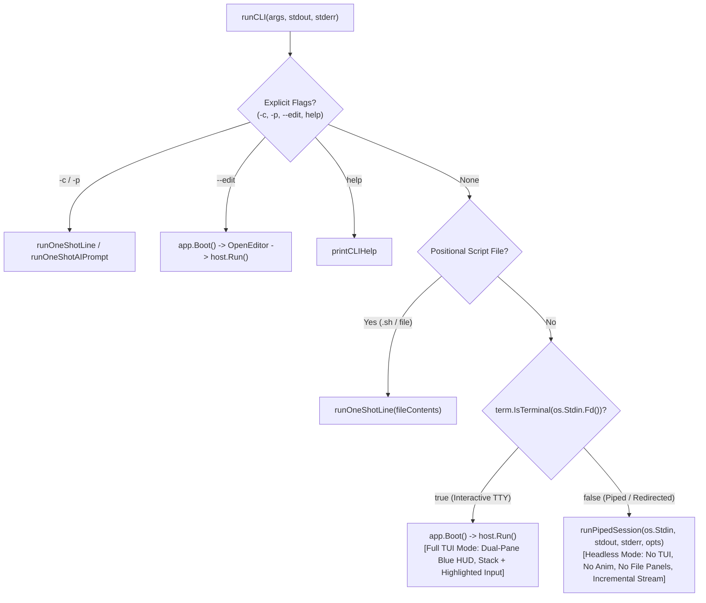

# Kabibi Input Classification, Highlighting, and Piped Mode

## 1. Implementation Status

Kabibi is a hybrid bash shell and natural-language AI assistant. The three planned stages below are implemented and share one classifier. “Three-way” refers to the primary decision among shell input, incomplete shell input, and AI input; `RouteEmpty` and `RouteBuiltin` are additional control-flow outcomes.

1. **Stage 1 — Pre-Execution Three-Way Input Classifier & Multiline TTY Continuation (Prerequisite):**
   - `ExecutionSession.ClassifyInput` is a deterministic **pre-execution classifier** that distinguishes:
     1. **`RouteEmpty`**: blank or comment-only input.
     2. **`RouteBuiltin`**: standalone `exit` or `quit`.
     3. **`RouteIncomplete`**: syntactically incomplete bash construct (e.g. `if true; then`, `for i in 1 2; do`, trailing `|`/`&&`/`\`, unclosed `{`/`(`/`'`, or unclosed here-doc) whose leading command token is a valid shell keyword, builtin, function, script, or executable.
     4. **`RouteShell`**: complete, syntactically valid bash command or compound block whose leading command resolves against the session's full command-resolution chain.
     5. **`RouteAI`**: natural-language prompt — either because the leading command token does not resolve as a shell command/keyword/assignment, or because the input contains a bash syntax error that is not a valid in-progress shell construct.
   - Integrate `RouteIncomplete` into interactive TTY mode (`Shell` + `PromptInput`) so pressing `Enter` on an incomplete shell block inserts a newline and continues editing rather than prematurely executing or routing to AI.

2. **Stage 2 — Classifier-Driven Subtle Inline Syntax Highlighting (`PromptInput`):**
   - Built **directly on the back of Stage 1's classifier** (not as an independent lexer pass).
   - Serves as immediate visual validation of the classifier while typing:
     - If the classifier routes the current buffer to **`RouteAI`**, the input is **not highlighted as bash** — it renders cleanly in the default terminal foreground style.
     - If the classifier routes the current buffer to **`RouteShell`**, **`RouteBuiltin`**, or **`RouteIncomplete`**, tokens are highlighted using a **muted, desaturated mid-luminance palette** (greyish-blue, greyish-green, greyish-orange, greyish-violet, slate-grey) calibrated to remain legible and understated on **both dark/black and light/white terminal backgrounds**.

3. **Stage 3 — Early-Fork Headless Piped Mode (`kabibi/piped.go` + `kabibi/main.go`):**
   - When `kabibi` is invoked with no one-shot flags and stdin is not a terminal (`!term.IsTerminal(os.Stdin.Fd())`), `runCLI` routes to `runPipedSession` — bypassing `app.Boot()`, `DualPaneWidget` (file panels are not instantiated), and `ui.Host` (no raw mode or Kabibi spinner ticker).
   - Process standard input incrementally line-by-line using the **same classifier**: accumulating multiline blocks while `RouteIncomplete`, executing complete `RouteShell` blocks immediately (without waiting for whole-stream EOF), and routing each `RouteAI` line to `LazyAIRunner`.
   - Retain PTY execution (`pty.Start` and `ManagedPTY`) for child processes spawned by shell commands and AI `exec` tools.

---

## 2. Stage 1: Three-Way Pre-Execution Classifier & Multiline TTY Support

### 2.1 Why Pre-Execution Command Resolution Is Required

Previously, `ClassifyInput` only ran `syntax.NewParser().Parse`:
- Single-line plain-English prompts without punctuation (e.g. `Name a bridge in Paris`) parsed as valid bash (`CallExpr` with command `Name` and 4 arguments), returning `RouteShell` at classification time and only falling back to AI during `RunCommand` via `ErrUnknownCommandAtStart`.
- English prompts containing an apostrophe (e.g. `What's the largest file in this directory?`) caused `mvdan/sh` to report an unclosed single quote (`syntax.IsIncomplete(err) == true`).

To support both **multiline shell continuation** and **classifier-driven syntax highlighting**, the classifier must distinguish **before execution** whether the user is typing a real shell construct or a natural-language sentence.

### 2.2 Pre-Execution Command Resolution (`ExecutionSession.CanResolveCommand`)

`ExecutionSession.CanResolveCommand` performs a read-only check without spawning or mutating anything. It accounts for:

1. **Shell Keywords & Control Structures:**
   - Reserved words (`if`, `for`, `while`, `until`, `case`, `select`, `function`, `{`, `(`, `[[`, `((`, `!`, `time`, `coproc`).
2. **Pure Variable Assignments / Redirections:**
   - A `CallExpr` with `len(Assigns) > 0` and `len(Args) == 0` (e.g. `FOO=bar`), or bare redirections.
3. **Session & Interpreter Builtins:**
   - Lifecycle builtins (`exit`, `quit`, `help`).
   - Standard POSIX/Bash builtins via `interp.IsBuiltin(name)`.
   - User-defined shell functions registered in `es.runner.Funcs[name]`.
   - In-process nested shell names via `isNestedShellBuiltinName(name)` (`bash`, `sh`, `kabibi`).
   - Custom Kabibi builtins: `git` (`gitBuiltinMiddleware`), `web` and `cdp` (`webBuiltinMiddleware`), and all registered u-root coreutils via `LookupURootCommand(name)`.
4. **Scripts & Host Executables:**
   - Relative or absolute `.sh` or `#!` script files in `es.Dir()`.
   - Platform-aware host executables via `resolvePlatformExecutable(name, es.Dir(), es.EnvMap())` (honoring Windows `PATHEXT` and `PATH`) and `interp.LookPathDir`.

### 2.3 Classifier Decision Matrix (`ClassifyInput`)

Given raw input string $S$:

1. If input is whitespace-only, return `RouteEmpty`.
2. Parse using `syntax.NewParser(syntax.KeepComments(false))`.
   - A definitive parse error (`!syntax.IsIncomplete(err)`) routes to `RouteAI`.
   - An incomplete parse routes to `RouteIncomplete` only when `hasShellHead` recognizes a shell compound, keyword, assignment, dynamic command word, or resolvable command; otherwise it routes to `RouteAI`. This is what keeps questions such as `What's the largest file?` from becoming shell continuations.
3. For a successful parse, no statements means `RouteEmpty`; a standalone `exit` or `quit` means `RouteBuiltin`.
4. An unescaped trailing backslash before the final newline is explicitly treated as `RouteIncomplete` when the input has a shell head; the parser may otherwise accept that input at EOF. A backslash escaping a trailing space is not a continuation.
5. A compound command, dynamic command word, assignment-only command, or resolvable first command routes to `RouteShell`. A complete command whose leading word is unresolved (such as `Name` in `Name a bridge in Paris`) routes to `RouteAI`.

This classifier is a routing heuristic, not a full Bash validator: definitive syntax errors route to AI so prose can still receive the natural-language fallback.
   - *Defense in depth:* Keep `ErrUnknownCommandAtStart` in `RunCommand` as a safety net in case an executable disappears between classification and execution.

### 2.4 Interactive TTY Multiline Continuation (`PromptInput` & `Shell`)

1. **`PromptInput` Newline Preservation:**
   - Update `PromptInput.SetValue` and `PromptInput.insertText` so embedded `\n` newlines are preserved (normalizing `\r\n` $\rightarrow$ `\n`) instead of flattening newlines to spaces. `buildVisualLayout` in `kabibi/ui/shell/prompt_input.go` already supports `\n` row breaks!
   - Add `InsertNewline()` on `PromptInput` to insert `\n` at `cursorPos`.
2. **`Enter` Key Handling in `Shell.handleKeyEvent`:**
   - When the user presses `Enter` in TTY mode:
     - Query `route, _ := s.execSess.ClassifyInput(s.input.Value())`.
     - If `route == RouteIncomplete`, call `s.input.InsertNewline()` and `s.invalidate()` instead of `s.submitAndExecuteAsync()`.
     - If `route` is `RouteShell`, `RouteAI`, `RouteBuiltin`, or `RouteEmpty`, submit and execute as normal.
   - Pressing `Ctrl+C` while editing a multiline buffer resets the entire buffer cleanly.

---

## 3. Stage 2: Classifier-Driven Subtle Inline Syntax Highlighting

### 3.1 Core Rule: Highlighting Follows the Classifier

Syntax highlighting in `PromptInput` is **strictly gated by the Stage 1 classifier**:
- `Shell` wires a classifier/highlighter callback into `PromptInput`.
- On every render/update of `PromptInput.Value()`:
  1. Run the Stage 1 classifier on `value`.
  2. **If `route == RouteAI`:** Do **not** highlight as bash. Every rune of `value` uses the default terminal foreground (`CharResetForegroundDefault`), visually confirming to the user that Kabibi sees the line as natural-language AI chat.
  3. **If `route` is `RouteShell`, `RouteBuiltin`, or `RouteIncomplete`:** Apply subtle bash token highlighting across the input runes.

### 3.2 Dual-Background Subtle Colour Palette

To avoid a loud or "childish" appearance while keeping the colors legible on **both black (`#000000`) and white (`#FFFFFF`) terminal backgrounds**, the muted palette is checked by an automated contrast test requiring at least **3:1** against both backgrounds:

| Token Category | Visual Description | Hex RGB | `terminal.Color` | Applies To |
| :--- | :--- | :--- | :--- | :--- |
| **Default / AI Text** | Terminal Default | — | `CharResetForegroundDefault` | Plain arguments, paths, and **entire buffer when `RouteAI`** |
| **Keywords & Builtins** | Greyish-Blue | `#5B82A6` | `0x5B82A6` | `if`, `then`, `else`, `fi`, `for`, `in`, `do`, `done`, `while`, `case`, `esac`, `echo`, `cd`, `export`, resolved command head |
| **Strings & Quotes** | Greyish-Green | `#5E8C6A` | `0x5E8C6A` | `'...'`, `"..."`, heredoc bodies |
| **Variables & Numbers** | Greyish-Orange | `#A67C52` | `0xA67C52` | `$VAR`, `${VAR}`, `$1`, `FOO=` assignment names, numeric literals |
| **Operators & Pipes** | Greyish-Violet | `#856B9E` | `0x856B9E` | `\|`, `&&`, `\|\|`, `;`, `>`, `>>`, `<`, `2>&1`, `(`, `)`, `{`, `}` |
| **Comments** | Muted Slate-Grey | `#76808A` | `0x76808A` | `# comment` |

### 3.3 Token Mapping into `buildVisualLayout`

- `buildVisualLayout` in `kabibi/ui/shell/prompt_input.go` accepts an optional per-rune style slice `[]terminal.Style` (or `StyleFunc`) for `value`:
  - The prompt prefix (`~/rustica፧`) always renders in its standard default style.
  - For `RouteShell` / `RouteBuiltin` / `RouteIncomplete`, lexer tokens (via `mvdan/sh/v3/syntax` AST walk or `chroma` bash lexer gated by the classifier) map byte/rune spans of `value` to the 5 subtle styles above.
  - Even when `route == RouteIncomplete` (for example, while the user is mid-way through typing `if [ -f foo ]; then` or an unclosed quote `'hello`), the lexer highlights the recognized keywords, operators, and partial string in real time.

---

## 4. Stage 3: Headless Piped Mode (`kabibi/piped.go`)

### 4.1 Entrypoint Routing & Non-TTY Guarantees (`kabibi/main.go`)

When `term.IsTerminal(os.Stdin.Fd())` is `false`:
1. **No TUI or Raw Mode:** `app.Boot()` and `host.Run()` are never called; `term.MakeRaw` is never invoked; Kabibi does not emit TUI cursor-positioning or screen-clearing sequences (child processes may still emit their own terminal output).
2. **File Panels Permanently Disabled:** `AppWidget` and `DualPaneWidget` are never instantiated; `Ctrl+O` and F-key dialogs do not exist in this mode.
3. **Animations Permanently Silenced:** Because `Shell` widget's 80ms `stackSpinnerFrames` ticker lives in `shell_widget.go`, bypassing `AppWidget`/`Shell` guarantees zero spinner frames are ever emitted. In `runPipedAI`, `onFeedback` is silenced by default (or logged as plain `[ai] ...` lines to `stderr` only when `--verbose` is set, stripping any `\r` spinner rewrites).

### 4.2 Incremental Line-by-Line & Block-Aware Stream Loop (`runPipedSession`)

Unlike a naive batch runner that slurps all of `stdin` until EOF before running the first command, `runPipedSession` uses `bufio.Reader` (`ReadString('\n')`, avoiding `bufio.Scanner`'s 64KB token limit) to process input **incrementally as lines arrive**:

1. Maintain an accumulator buffer `var pending strings.Builder`.
2. Read the next line from `stdin`:
   - Append the line to `pending`.
3. Classify `current := pending.String()` using Stage 1's `route, parsed := es.ClassifyInput(current)`:
   - **`RouteIncomplete`**:
     - If **not at EOF**, keep reading the next line into `pending` (allowing `if ... then ... fi`, `for ... do ... done`, trailing `\`, trailing `|`, and here-docs to span multiple lines naturally).
     - If **at EOF** (the stream ended while a shell construct was still unclosed), print `kabibi: incomplete shell input at end of stdin` to stderr and return exit code `2`; do not pass the incomplete buffer to the AI or execute it.
   - **`RouteEmpty`**:
     - `pending.Reset()` and continue.
   - **`RouteBuiltin`** (`exit` / `quit`):
     - Return `lastExitCode` immediately.
   - **`RouteShell`**:
     - `pending.Reset()`.
     - Execute `rec, runErr := es.RunCommand(ctx, current, parsed, shell.SourceUserShell, writeStdout)`.
     - If `errors.Is(runErr, shell.ErrUnknownCommandAtStart)` (safety-net fallback), route `current` to `runPipedAI`.
     - Otherwise update `lastExitCode = rec.ExitCode`.
   - **`RouteAI`**:
     - `pending.Reset()`.
     - Execute `runPipedAI(ctx, aiRunner, strings.TrimSpace(current), stdout, stderr, opts.verbose)`. AI input is handled one classified physical line at a time; multiline accumulation is reserved for inputs classified as incomplete shell syntax.
     - Record the AI turn in `es` history so subsequent shell commands or AI turns in the same piped stream share full session context.
4. Shell and AI output is streamed to stdout. Output-write failures are reported to stderr and produce a non-zero result. At EOF, the session returns the last command or AI turn's exit code; standalone `exit`/`quit` returns the current last exit code immediately.

### 4.3 Retained PTY Execution for Child Processes & AI Tools

Even though Kabibi itself reads from a non-TTY `stdin` and streams to `stdout`/`stderr`:
1. **User Shell Child Processes (`runResolvedCommand` in `shell.go`):**
   - Continue to launch external executables in a PTY (`pty.Start` with `80x24` default geometry from `ExecutionSession`), pumping output chunks directly to `stdout`.
   - Because `ExecutionSession.ttyIn` is a closed pipe reader, unredirected child commands receive immediate EOF on their stdin rather than stealing remaining command lines from Kabibi's `stdin` script stream. Commands with explicit input redirection or pipelines (`echo foo | grep foo`, `cat <<EOF`) receive their redirected stdin normally.
2. **AI `exec` Tool Child Processes (`ExecuteAIToolCommand` in `exec_session.go`):**
   - Continue to use `ManagedPTY` (`pty.Start`) + virtual terminal settling (`terminal.FromANSI` / `CleanBytesToText`) and background promotion (`term_read`, `term_input`, `term_kill`).

---

## 5. Summary Comparison Across Modes

| Capability | Interactive TUI Mode (`isTTY == true`) | Headless Piped Mode (`isTTY == false`) |
| :--- | :--- | :--- |
| **Entrypoint** | `app.Boot()` $\rightarrow$ `host.Run()` | `runPipedSession()` in `kabibi/piped.go` |
| **Terminal Raw Mode** | Yes (`term.MakeRaw`) | No (standard streams) |
| **Blue File Panels (`Ctrl+O`)** | Available (hidden by default) | **Permanently disabled (not instantiated)** |
| **80ms Spinner Animation** | Active on running block | **Permanently silenced** |
| **Input Classification** | Shared shell/incomplete/AI classifier (plus empty and lifecycle routes) | Shared shell/incomplete/AI classifier (plus empty and lifecycle routes) |
| **Multiline `if`/`for`/quotes** | `Enter` inserts `\n` while `RouteIncomplete` | Accumulates lines while `RouteIncomplete` |
| **Inline Syntax Highlighting** | Subtle 5-color bash palette; disabled on `RouteAI` | N/A (no prompt echo) |
| **Child Process & AI PTY** | Enabled (`pty.Start` / `ManagedPTY`) | **Enabled (`pty.Start` / `ManagedPTY`)** |
| **Session State (`cd`, `export`)** | Persistent `ExecutionSession` | Persistent `ExecutionSession` |

---

## 6. Slash Commands

Slash commands share a registry and literal-argument parser. In TTY mode, matching commands appear in the footer; Up/Down and Tab cycle through multiple matches, Enter accepts a partial match, and Tab completes a unique match. Tab after a completed command opens its argument position. Piped mode has no hints.

- `/settings` opens the settings dialog in TTY mode. In piped mode it reports that the TUI is required and prints the AI configuration JSON path.
- `/model` runs the existing AI setup flow; piped mode uses numbered/text prompts on standard input and output.
- `/panels` toggles file panels in TTY mode. `/edit` and `/panels` report that the TUI is required in piped mode.
- `/copy`, `/move`, `/rename`, `/delete`, and `/remove` accept paths in either mode; `/edit` is TUI-only. In TTY mode, no paths use the selected panel item; if the panels are hidden, these file actions show them first. Piped copy/move commands take one or more sources followed by a destination directory; `/rename` takes a source and destination; `/delete` requires `--yes` followed by one or more paths. Piped copy and move fail on destination collisions.
- `/remove` aliases `/delete`; `/download` is browser-only and downloads the exact `kabibi.bat` URL that successfully loaded the running artifact.

Quoted paths are supported, but shell operators, redirections, and expansions are rejected in slash-command invocations. Absolute executable paths continue through normal shell routing.

---

## 7. Implemented Coverage

### Stage 1: Implemented Classifier & Multiline TTY Continuation
- **Files:** `kabibi/ui/shell/exec_session.go`, `kabibi/ui/shell/prompt_input.go`, `kabibi/ui/shell/shell_widget.go`
- `InputRoute` includes `RouteIncomplete`; `CanResolveCommand` checks builtins, functions, nested shells (`bash`/`sh`/`kabibi`), `git`/`web`/`cdp`, u-root commands, local scripts, and platform-resolved executables.
- `ClassifyInput` routes input before execution. `PromptInput` preserves newlines, and `Shell` inserts one on Enter when the current input is `RouteIncomplete`.
- **Unit Tests (`kabibi/ui/shell/shell_ai_test.go`, `prompt_input_test.go`):**
  - Verify `if true; then`, `for i in 1 2; do`, `echo "unclosed`, `echo hi |`, and `echo hi \` classify as `RouteIncomplete`.
  - Verify `Name a bridge in Paris`, `What's the largest file?`, and `explain (in detail) why` classify immediately as `RouteAI`.
  - Verify pressing `Enter` in TTY `Shell` on `if true; then` inserts `\n` and waits until `fi` before executing.
  - Verify Ctrl+C clears an incomplete multiline buffer without submitting it.

### Stage 2: Implemented Classifier-Driven Subtle Inline Syntax Highlighting
- **Files:** `kabibi/ui/shell/prompt_input.go`, `kabibi/ui/shell/shell_widget.go`
- `PromptInput` uses the muted palette (`#5B82A6`, `#5E8C6A`, `#A67C52`, `#856B9E`, `#76808A`) with classifier-backed styling: `RouteAI` uses the default foreground, while shell, builtin, and incomplete routes receive bash token colors.
- **Unit Tests (`kabibi/ui/shell/prompt_input_test.go`):**
  - Verify `echo "hello" | cat $HOME` uses the expected distinct colors for the builtin, string, pipe operator, and variable.
  - Verify `Name a bridge in Paris` and `What's the time?` render with default foreground style on every rune (`CharResetForegroundDefault`).
  - Verify incomplete bash (`if true; then`) still highlights its keyword and operator tokens.
  - Verify every palette color has at least 3:1 contrast against pure black and white.

### Stage 3: Implemented Headless Piped Mode
- **Files:** `kabibi/piped.go`, `kabibi/main.go`, `kabibi/piped_test.go`
- `runPipedSession` and `runPipedAI` process input incrementally with `bufio.Reader` and the shared classifier.
- `runCLI` checks `term.IsTerminal(os.Stdin.Fd())` and routes non-TTY stdin to `runPipedSession`.
- **Unit Tests (`kabibi/piped_test.go`):**
  - Prove a command's output arrives while an `io.Pipe` writer is still open, before stdin reaches EOF.
  - Verify persistent shell state and multiline `if`/`for` blocks and heredocs.
  - Verify mixed shell commands and per-line AI fallback, plus AI-runner failures.
  - Verify last-command exit-code behavior and shell/AI output-writer errors, including short writes.
- **CLI integration test (`kabibi/cli_test.go`):**
  - Verify redirected stdin selects piped mode and emits only expected command output, with no ANSI escape sequences, carriage-return animation, or unexpected stderr.

The automated tests cover the behavioral checks listed above. The root-package suite still fails `TestExecutableDoesNotImportCharmUIStack`: `go mod why` traces Bubble Tea and Lipgloss through `ui/shell` → u-root's `gosh` → `bubbline`. This is a static dependency-graph issue, separate from piped mode's runtime behavior. Headless mode guarantees no TUI startup or Kabibi animation at runtime; it does not remove those dependencies from the executable.
