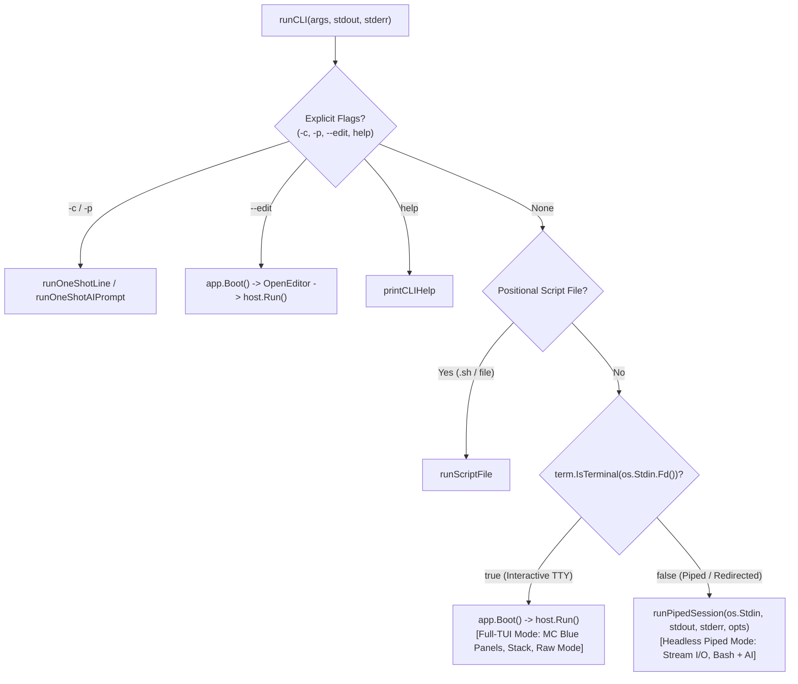

# Kabibi Architectural Plan: Decoupling Full-TUI ANSI Mode from Piped / Non-TTY Mode

## 1. Executive Summary & Design Problem

Kabibi is designed as a wearable all-weather terminal shell, dual-pane Norton Commander-style HUD, syntax editor, and conversational AI assistant.

When invoked interactively from a terminal emulator (Windows Terminal, xterm, WezTerm, Alacritty, or macOS Terminal), Kabibi operates with:
- Raw terminal mode (`golang.org/x/term.MakeRaw`),
- ANSI cursor positioning (`\x1b[row;colH`, `\x1b[nA`, `\x1b[nB`),
- Double-buffered cell diffing (`terminal.CellBuf`),
- The `AppWidget` composition hierarchy: bottom-up growing command stack, Ctrl+O blue file manager panels (`DualPaneWidget`), and active status lines with animated spinners.

However, in Unix and Windows piping scenarios, e.g.:
```bash
echo "cargo check" | kabibi
cat build.sh | kabibi
find . -name "*.rs" | kabibi "summarize these files"
git diff | kabibi "review this diff" > review.md
```
or in CI/CD automation and headless subshell invocations, `os.Stdin` (and/or `os.Stdout`) is **not a TTY** (`isatty == false`).

### Current Failure Mode
Currently in `kabibi/main.go`, when `len(os.Args) == 1` (no flags or positional parameters), `runCLI` unconditionally calls:
```go
appWidget, host, err := app.Boot()
...
err := host.Run()
```
Inside `host.Run()`, it executes `term.MakeRaw(os.Stdin.Fd())`. When `os.Stdin` is a pipe or `/dev/null`, `term.MakeRaw` fails immediately with `ENOTTY` (or Windows `The handle is invalid`), causing Kabibi to abort without executing any input. Even if raw mode were bypassed, emitting cell buffers, ANSI control escapes, and Norton Commander blue panel frames into a pipe corrupts downstream filters and loggers.

---

## 2. Fundamental Architectural Dilemma: Early Fork vs. Late Widget Conditionalization

We must resolve whether to:
1. **Approach A (Early Fork / Headless Session):** Split execution early in `main.go`/`runCLI`, completely bypassing `AppWidget`, `DualPaneWidget`, and `ui.Host`, running a stream-oriented command loop directly on `shell.ExecutionSession`.
2. **Approach B (Late Conditionalization / Headless Widget Hierarchy):** Start the full composition logic (`app.Boot()`, `AppWidget`, `ui.Host`), but add conditional branches throughout the widget tree, rendering pipelines, and event loop to suppress panels, spinners, and ANSI sequences when non-TTY.

### 2.1 Detailed Evaluation of Approach B (Late Conditionalization inside Widgets)

In Approach B, `app.Boot()` is always constructed. `AppWidget` and `ui.Host` are instantiated, and each component is parameterized with `isTTY bool`:
- `ui.Host.Run()` checks `isTTY`. If false, it disables `term.MakeRaw`, disables double-buffering (`prevBuf`/`currBuf`), disables cursor position tracking, and instead reads raw bytes from stdin to feed as pseudo-events into `msgCh`.
- `AppWidget` checks `isTTY`. If false, it disables Ctrl+O handling, forces `panelsVisible = false`, disables dialogs, and delegates solely to `sh`.
- `Shell` checks `isTTY`. If false, it suppresses `BlockBanner`, suppresses `PromptInput` rendering, suppresses frame tick timers (`time.NewTicker(16*time.Millisecond)` for spinners), and intercepts `dynamicWriter` writes to send them directly to `os.Stdout` rather than caching in `CommandBlock` and converting from ANSI cells.

#### Deficiencies of Approach B:
1. **Severe Coupling & Leaky Abstractions:** `ui.Widget` is intrinsically a cell-grid rendering interface (`Render(rect, buf)` + `HandleEvent(event)`). A piped stream is not a 2D spatial canvas with width, height, and cells; it is an unbounded 1D byte stream. Forcing 1D stream execution into a 2D widget lifecycle creates "ghost widgets" that never render or receive real input events.
2. **Resource & Goroutine Bloat:** `ui.Host` spawns multiple coordinator goroutines (event channel pumps, resize listeners, signal handlers). In a short-lived piped command (`echo "ls" | kabibi`), spawning these UI loops and immediate shutdown sequences adds startup latency and teardown race conditions.
3. **Fragile Invariants:** Every new UI feature, animation, keybinding, or modal dialog added to `AppWidget` would need explicit `if !isTTY { return }` defensive guards, increasing bug surface and regression risk.
4. **Maintenance Overhead:** The UI code becomes cluttered with non-UI stream logic, obscuring the clean geometry and slack-gap math documented in `2-stack-widgets.md` and `3-blue.md`.

### 2.2 Detailed Evaluation of Approach A (Early Fork / Headless Session)

In Approach A, `kabibi` treats terminal interaction and stream piping as two distinct frontend hosts for the same underlying core engine:
- The core execution engine is **`shell.ExecutionSession`** (the persistent `mvdan/sh` runner, environment, working directory, and command classification) + **`shell.LazyAIRunner`** (LiteRT-LM inference session with function-calling tools).
- When `isatty(stdin) == true && isatty(stdout) == true`: `runCLI` boots the **TUI Host** (`app.Boot()` $\rightarrow$ `AppWidget` $\rightarrow$ `ui.Host`), providing the rich visual stack, blue file manager, and editor.
- When `isatty(stdin) == false` (or explicit batch/piped flags): `runCLI` boots the **Piped Stream Host** (`runPipedSession`), which connects `io.Reader` (stdin) directly to `es.RunCommand` and `aiRunner.RunTurn`, writing plain bytes directly to `os.Stdout` and `os.Stderr`.

#### Advantages of Approach A:
1. **Zero UI Interference:** The TUI codebase (`ui/`, `AppWidget`, `DualPaneWidget`, `EditorWidget`) remains 100% dedicated to clean, uncompromising, high-performance terminal UI rendering without pollution.
2. **Clean Stream Semantics:** `runPipedSession` behaves exactly like a traditional Unix shell (`bash`, `sh`, `zsh`) or streaming AI CLI tool: line-buffered or multi-statement parsing, proper exit code propagation, no escape code pollution.
3. **Shared Core Logic:** Both interactive TUI and piped mode share the exact same `shell.ExecutionSession`, bash parsing, platform executable resolver (`resolvePlatformExecutable`), PATHEXT handling, and `LazyAIRunner` system prompt and tools.
4. **Testability:** Piped mode can be tested cleanly with standard Go `bytes.Buffer` input/output without requiring mock terminal sizing, escape sequence parsing, or virtual raw-mode hooks.

### 2.3 Verdict & Decision

**We definitively choose Approach A (Early Fork).**
The shared engine is `shell.ExecutionSession` and `shell.AIRunner`. The TUI and Piped modes are two presentation adapters around that engine.

---

## 3. Piped Mode Behavior & Operational Semantics

Piped mode must handle both traditional shell commands and conversational AI requests, distinguishing them intelligently just as Kabibi does interactively.

### 3.1 Input Scenarios in Piped Mode

1. **Pure Shell Script / Command Stream:**
   ```bash
   printf "cd /tmp\npwd\nls -la\n" | kabibi
   ```
   *Behavior:* Each command executes in sequence within the same persistent `ExecutionSession`. Working directory changes (`cd /tmp`) and environment assignments (`export FOO=bar`) persist from line to line. Output is streamed directly to stdout. If any command fails with a non-zero exit code, execution halts and returns that exit code (configurable via standard shell semantics).

2. **AI Prompt Stream:**
   ```bash
   echo "explain what the files in this directory do" | kabibi
   ```
   *Behavior:* The input line is classified by `es.ClassifyInput(line)`. Because it fails shell syntax or starts with an unresolvable command (`ErrUnknownCommandAtStart`), it routes automatically to `LazyAIRunner`. The AI's response content is streamed straight to stdout. Any deliberation/tool activity is suppressed or emitted to stderr if `--verbose` is specified.

3. **Hybrid Shell + AI Stream:**
   ```bash
   echo "git status" | kabibi
   echo "write a commit message for these changes" | kabibi
   ```
   or in a single stream:
   ```bash
   cat << 'EOF' | kabibi
   cargo check
   fix the type errors reported above
   EOF
   ```
   *Behavior:* Line 1 runs `cargo check` via bash. Its output is emitted to stdout and recorded in the persistent session history (`es.RecordBlock`). Line 2 is classified as an AI request; the AI tool context includes the recent command output from the session history, allowing it to inspect the errors and respond accordingly.

4. **Batch AI Invocation with Positional Arguments:**
   ```bash
   git diff | kabibi "summarize this diff"
   ```
   *Behavior:* Positional arguments form the AI prompt (`opts.aiPrompt`), while standard input (the diff) is supplied as input context to the prompt or tool environment.

---

## 4. Technical Architecture & Component Design

### 4.1 Entrypoint Routing (`kabibi/main.go`)

`runCLI` inspects flags and file descriptors before launching any UI components:



### 4.2 Stream Processing Engine (`runPipedSession`)

The piped runner lives in `kabibi/piped.go` (or `kabibi/ui/shell/piped.go`):

```go
type PipedSessionOptions struct {
    Verbose    bool
    SystemCtx  string
    WorkingDir string
}

func RunPipedSession(
    ctx context.Context,
    r io.Reader,
    stdout, stderr io.Writer,
    opts PipedSessionOptions,
) int
```

#### Step-by-Step Execution Lifecycle:
1. **Initialize Engine:**
   - Instantiate `es, err := shell.NewExecutionSession(opts.WorkingDir)`.
   - Instantiate `aiRunner := shell.NewLazyAIRunner(es)`.
   - Configure `aiRunner.SetVerbose(opts.Verbose)`.
   - Configure `aiRunner.SetSystemContext(opts.SystemCtx)`.
   - Ensure `defer aiRunner.Close()` is called to flush embeddings and close inference engines cleanly.
2. **Scanner & Statement Parsing:**
   - Standard input can be read line-by-line via `bufio.Scanner` or statement-by-statement via `syntax.NewParser()`.
   - *Line-by-line vs. Script Parsing:*
     - If the entire stdin is valid bash syntax (e.g. a script with `for` loops or `if` statements), parsing it as a whole via `syntax.NewParser().Parse(r, "stdin")` is preferred if it parses without error.
     - If syntax parsing fails on the full block, it may be a conversational natural-language prompt or a mix of single-line commands and prompts.
     - Therefore, the resilient algorithm is:
       1. Read all input (up to a sensible max buffer, e.g. 10MB) into memory or a temp buffer.
       2. Attempt full parse with `syntax.NewParser()`.
       3. If it parses as valid shell and does not contain `ErrUnknownCommandAtStart` on the first statement: execute via `es.RunCommand` directly.
       4. If it fails to parse as valid shell:
          - If the entire text contains no newlines (or a single prompt), send the entire text to `aiRunner.RunTurn`.
          - If the input contains multiple lines, iterate line-by-line: classify each line via `es.ClassifyInput(line)`.
            - `RouteEmpty`: no-op.
            - `RouteBuiltin` (`exit`, `quit`): terminate piped session.
            - `RouteShell`: execute via `es.RunCommand`. If `ErrUnknownCommandAtStart` is returned, fall back to `aiRunner.RunTurn(line)`.
            - `RouteAI`: execute via `aiRunner.RunTurn(line)`.

### 4.3 Clean Stream Output Formatting (No ANSI Spills)

In piped mode:
1. **Stdout/Stderr Separation:**
   - Normal command stdout writes directly to `stdout`.
   - Normal command stderr writes directly to `stderr`.
   - AI assistant answers write directly to `stdout`.
   - AI diagnostics and tool activity messages (e.g., `[exec: cargo build]`) write to `stderr` only if `--verbose` is enabled; otherwise, they are suppressed so piped pipelines remain completely clean.
2. **Stripping Visual Trappings:**
   - No startup banner (`formatStartupBanner`).
   - No prompts (`~/rustica፧ `).
   - No cursor visibility toggles (`\x1b[?25h`).
   - No color codes or clear screen sequences (`\x1b[2K`, `\x1b[0m`).

---

## 5. WASM / Browser & Subprocess Considerations

### 5.1 Browser `washmhost`
In `washmhost` (the browser runner via `xterm.js` and `washmhost.js`):
- `fd_isatty(0)` currently returns `1` because `xterm.js` simulates a terminal. Thus, in the browser, Kabibi boots in full TUI interactive mode with the dual blue panels and stack widgets as expected.
- If someone mounts a virtual pipe in `washmhost` (e.g. redirected stdin from a virtual file), `fd_isatty(0)` returning `0` will smoothly switch to piped mode without trying to enter raw mode (which WASI doesn't support anyway).

### 5.2 Windows & PowerShell Piping
On Windows, piping via PowerShell (`"dir" | kabibi.bat`) or CMD (`type file.txt | kabibi.bat`):
- `os.Stdin.Fd()` is a Windows named pipe or anonymous pipe handle.
- `term.IsTerminal(os.Stdin.Fd())` reliably returns `false`.
- Piped mode ensures `kabibi.bat` behaves predictably in PowerShell and batch scripts.

---

## 6. Implementation Roadmap & Verification Plan

### Phase 1: Engine Foundation
- Ensure `shell.ExecutionSession` exposes all needed hooks for headless streaming:
  - `RunCommand` already supports streaming callbacks (`onChunk func([]byte)`).
  - Verify working directory and environment variables persist across sequential calls to `RunCommand`.

### Phase 2: Implement `RunPipedSession`
- Create `kabibi/piped.go` (or `kabibi/ui/shell/piped.go`).
- Implement the resilient two-tier execution logic (full script parse $\rightarrow$ line-by-line fallback with AI routing).
- Ensure graceful handling of `EOF`, `exit`/`quit`, and signal cancellations.

### Phase 3: Wire `runCLI` in `kabibi/main.go`
- Add terminal check:
  ```go
  if len(opts.positional) == 0 && opts.command == "" && opts.prompt == "" && opts.edit == "" && !opts.help {
      if !term.IsTerminal(os.Stdin.Fd()) {
          return runPipedSession(os.Stdin, stdout, stderr, opts)
      }
  }
  ```

### Phase 4: Rigorous Test Suite
- Write unit tests in `kabibi/piped_test.go`:
  1. `TestPiped_PureBashCommands`: Feed `echo "hello"\nexport TEST=1\necho $TEST\n` to a piped session; assert output equals `hello\n1\n` and exit code is 0.
  2. `TestPiped_ExitBuiltin`: Feed `echo "before"\nexit\necho "after"\n`; assert `after` is never executed.
  3. `TestPiped_AIFallback`: Feed an unknown command or natural query with mock `AIRunner`; verify it invokes the AI runner and writes content to stdout without ANSI codes.
  4. `TestPiped_NonZeroExit`: Feed a failing command; assert the session reports the non-zero exit code.
